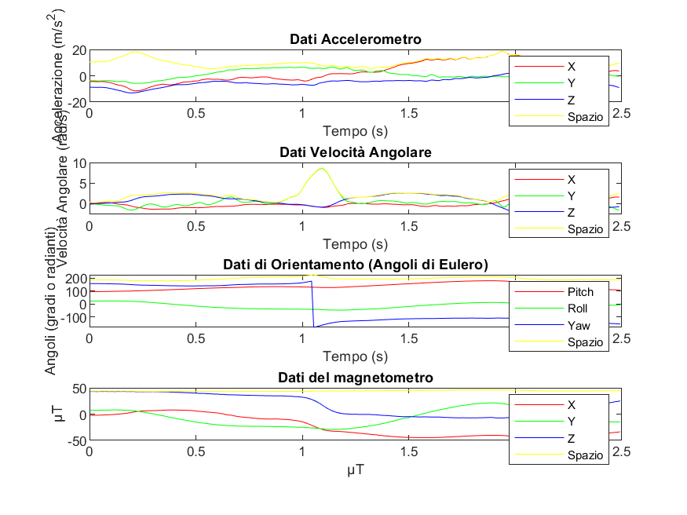

# Riconoscimento di gesti con lo smartphone – MATLAB e machine learning

Sistema che usa i sensori dello smartphone (accelerometro, giroscopio, magnetometro e orientamento) come controller e riconosce i gesti della mano con un modello di machine learning. Progetto di gruppo (4 persone) del corso di Internet of Things, Università Politecnica delle Marche.

> **English:** Smartphone-based gesture recognition in MATLAB. The phone's sensors are streamed through MATLAB Mobile, filtered, turned into statistical features and classified with an SVM model trained in Classification Learner (4 gestures, 100% validation accuracy on the collected dataset). University group project (4 people).

## Come funziona

**1. Acquisizione dei dati** (`acquisizione/`)
- `ScriptPrincipale.m` collega lo smartphone tramite MATLAB Mobile (campionamento a 100 Hz, 2,5 secondi per gesto) e apre l'interfaccia grafica (`GUI.m`).
- Per ogni gesto si registrano 5 ripetizioni, con la possibilità di salvare o ripetere ciascuna. Il protocollo prevede 24 gesti (lettere, numeri e comandi come GO, STOP, TURN LEFT, HELLO).
- Alla chiusura, `filtro.m` filtra i segnali con una media mobile ed estrae le caratteristiche; `visual.m` mostra i grafici delle acquisizioni.

**2. Addestramento e riconoscimento** (`classificazione/`)
- `ScriptforCL.m` e `GUIforCL.m` raccolgono il dataset di addestramento su 4 gesti: GO, COME, TURN LEFT e TURN RIGHT (15 ripetizioni per gesto per ogni partecipante).
- `filtroforCL.m` applica media e deviazione standard mobili ed estrae le caratteristiche statistiche di ogni asse (media, deviazione standard, mediana, IQR, curtosi, asimmetria, energia e altre): il risultato è `features_CL.csv`, 240 acquisizioni × 196 caratteristiche.
- Con il Classification Learner di MATLAB è stato addestrato un modello **SVM** (`SVMmodel.mat`), che ha raggiunto un'accuratezza del 100% in validazione sul dataset raccolto.
- `scriptAcquisition.m` registra un nuovo gesto in tempo reale e lo classifica con il modello.

## Requisiti

- MATLAB con **MATLAB Support Package for Apple iOS Sensors** (o Android) e l'app **MATLAB Mobile** sullo smartphone
- **Statistics and Machine Learning Toolbox**

## Dati

Il repository contiene solo il dataset delle caratteristiche già estratte (`features_CL.csv`), che non include dati personali. Le registrazioni grezze delle acquisizioni non sono pubblicate.

## Team

Daria Coccia, Nicholas Marra, Alessandro Ripani, Suemi Vincenti Cavasassi. Nel gruppo mi sono occupato dello sviluppo dell'algoritmo di riconoscimento.
